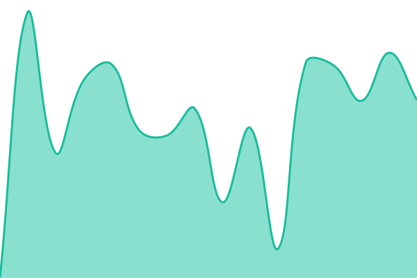

# Boilerexams Status

Uptime monitoring and the status page for Boilerexams and BoilerClasses, run by [Upptime](https://upptime.js.org) on GitHub Actions and Pages. Checks run every 5 minutes; outages open an issue here automatically and close it when the site recovers. Everything is configured in [`.upptimerc.yml`](.upptimerc.yml).

<!--start: status pages-->
<!-- This summary is generated by Upptime (https://github.com/upptime/upptime) -->
<!-- Do not edit this manually, your changes will be overwritten -->
<!-- prettier-ignore -->
| URL | Status | History | Response Time | Uptime |
| --- | ------ | ------- | ------------- | ------ |
|  [Boilerexams](https://boilerexams.com/) | 🟩 Up | [boilerexams.yml](https://github.com/boilerexams-revamp/boilerexams-status/commits/HEAD/history/boilerexams.yml) | 

 233ms
     
 | 

<a href="https://status.boilerexams.com/history/boilerexams">99.47%</a>
    

|  [Boilerexams API](https://api.boilerexams.com/v3/) | 🟩 Up | [boilerexams-api.yml](https://github.com/boilerexams-revamp/boilerexams-status/commits/HEAD/history/boilerexams-api.yml) | 

 790ms
     
 | 

<a href="https://status.boilerexams.com/history/boilerexams-api">99.47%</a>
    

|  [BoilerClasses](https://boilerclasses.com/) | 🟩 Up | [boiler-classes.yml](https://github.com/boilerexams-revamp/boilerexams-status/commits/HEAD/history/boiler-classes.yml) | 

 228ms
     
 | 

<a href="https://status.boilerexams.com/history/boiler-classes">99.51%</a>
    

|  [Staff sign-in](https://login.boilerexams.com/-/health/live/) | 🟩 Up | [staff-sign-in.yml](https://github.com/boilerexams-revamp/boilerexams-status/commits/HEAD/history/staff-sign-in.yml) | 

 661ms
     
 | 

<a href="https://status.boilerexams.com/history/staff-sign-in">99.53%</a>
    

<!--end: status pages-->
